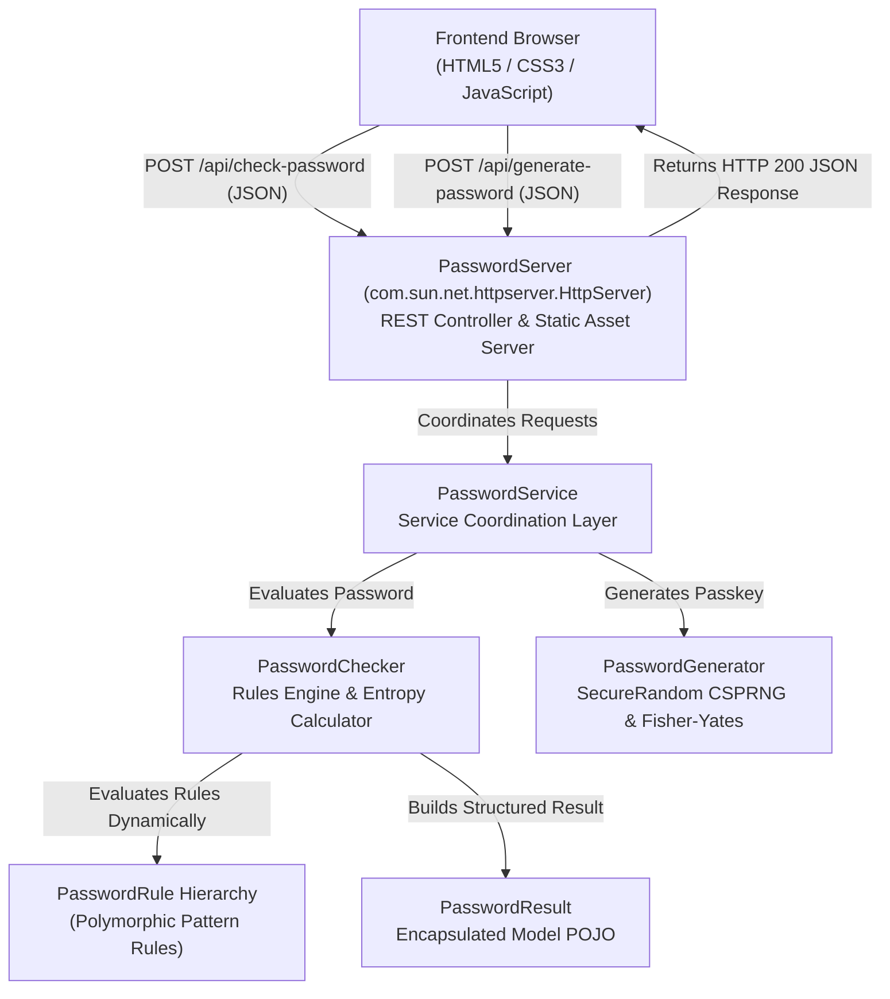

# SecurePass — Random Password Checker & Generator (Java OOP)

An enterprise-grade, cybersecurity-themed **Random Password Checker and Generator Web Application** engineered with **pure Java Object-Oriented Programming (OOP)** on the backend and modern semantic **HTML5, CSS3, and JavaScript** on the frontend.

Designed specifically for **first-year engineering college mini-projects**, this project requires **zero external dependencies** (no Maven, Gradle, or Tomcat setup required) and runs directly on standard Java SE (JDK 17 or higher).

---

## 1. Project Architecture & Communication Flow

The project follows a **Clean Multi-Tiered Architecture** where presentation, transport, service coordination, and domain business logic are strictly decoupled:



---

## 2. Directory Structure

```text
random-password-checker/
├── bin/                             # Compiled Java bytecodes (.class files)
├── public/                          # Frontend static assets served by Java backend
│   ├── index.html                   # Semantic, accessible UI with cybersecurity theme
│   ├── style.css                    # Modern CSS3 with glassmorphism, responsive grid & animations
│   └── script.js                    # Async fetch() API client & dynamic reactive UI
├── src/                             # Pure Java OOP source code
│   ├── AbstractPatternRule.java     # Base rule class demonstrating Abstraction & Inheritance
│   ├── DigitRule.java               # Concrete rule for numeric digits (Polymorphism)
│   ├── LengthRule.java              # Concrete rule for password length validation
│   ├── LowercaseRule.java           # Concrete rule for lowercase letters (Polymorphism)
│   ├── PasswordChecker.java         # Core strength analysis, Shannon entropy & heuristics
│   ├── PasswordGenerator.java       # Cryptographic CSPRNG generation & Fisher-Yates shuffle
│   ├── PasswordResult.java          # Encapsulated model POJO with JSON serialization
│   ├── PasswordRule.java            # Interface contract defining rule evaluation
│   ├── PasswordServer.java          # Built-in Java SE HttpServer controller & static file host
│   ├── PasswordService.java         # Service layer decoupling transport from domain logic
│   ├── SpecialCharRule.java         # Concrete rule for special symbols (Polymorphism)
│   └── UppercaseRule.java           # Concrete rule for uppercase letters (Polymorphism)
├── run.bat                          # One-click build and launch script for Windows
├── run.sh                           # One-click build and launch script for Linux / macOS
└── README.md                        # Documentation, OOP guide, and viva preparation
```

---

## 3. Java OOP Principles — Real Code Examples

This project was built to clearly demonstrate the four core pillars of Object-Oriented Programming:

### A. Encapsulation
- **Definition:** Wrapping data (attributes) and code (methods) together into a single unit and restricting direct external access to prevent unintended corruption.
- **In our code (`PasswordResult.java`):**
  - All attributes (`score`, `strengthLevel`, `entropyBits`, `requirementsMet`, `suggestions`) are strictly declared `private`.
  - Access is provided only through public getter methods and validated setter methods (e.g. `score` is clamped between 0 and 100).
  - Defensive copying is used when accessing lists (`Collections.unmodifiableList(...)`) to preserve immutability.
  ```java
  public class PasswordResult {
      private int score; // 0 to 100
      private String strengthLevel;

      public int getScore() {
          return this.score;
      }

      public void setScore(int score) {
          this.score = Math.max(0, Math.min(100, score)); // Defensive validation
      }
  }
  ```

### B. Abstraction
- **Definition:** Hiding complex implementation details and showing only essential features to the outside world.
- **In our code (`PasswordRule.java` & `PasswordService.java`):**
  - The `PasswordRule` interface declares *what* a rule must do (`evaluate(String password)`), hiding *how* regex pattern matching or length checking is performed.
  - The `PasswordService` facade abstracts the mathematical Shannon entropy calculations and cryptographic shuffling away from the HTTP controller.
  ```java
  public interface PasswordRule {
      String getName();
      boolean evaluate(String password);
      String getSuggestion();
      int getWeight();
  }
  ```

### C. Inheritance
- **Definition:** The mechanism by which one class acquires the properties and behaviors of a parent class, facilitating code reusability.
- **In our code (`AbstractPatternRule.java` & subclasses):**
  - `AbstractPatternRule` implements `PasswordRule` and provides reusable regex evaluation logic.
  - Subclasses like `UppercaseRule`, `LowercaseRule`, `DigitRule`, and `SpecialCharRule` extend `AbstractPatternRule`, passing specialized regex patterns through `super(...)`.
  ```java
  public abstract class AbstractPatternRule implements PasswordRule {
      protected final String ruleName;
      protected final String patternRegex;
      // Reusable evaluation logic
      public boolean evaluate(String password) {
          return password != null && password.matches(this.patternRegex);
      }
  }

  public class DigitRule extends AbstractPatternRule {
      public DigitRule() {
          super("Contains numeric digit (0-9)", ".*[0-9].*", "Add at least one numeric digit (0-9).", 20);
      }
  }
  ```

### D. Polymorphism
- **Definition:** The ability of an object to take on many forms; allowing a single interface to represent different underlying forms (dynamic method dispatch).
- **In our code (`PasswordChecker.java`):**
  - `PasswordChecker` holds a collection of type `List<PasswordRule>`.
  - At runtime, it loops through the collection and invokes `rule.evaluate(password)`. Java dynamically executes the appropriate overridden method (`LengthRule`, `UppercaseRule`, `DigitRule`, etc.) without knowing the exact concrete type ahead of time.
  ```java
  for (PasswordRule rule : this.rules) {
      if (rule.evaluate(password)) {
          requirementsMet.add(rule.getName());
          ruleScore += rule.getWeight();
      } else {
          suggestions.add(rule.getSuggestion());
      }
  }
  ```

---

## 4. How to Run the Project

### Prerequisites
- Java Development Kit (JDK 17, 21, or 25) installed and configured in your system `PATH`.
- To verify your Java installation, open a terminal and type:
  ```bash
  javac -version
  java -version
  ```

---

### Method A: One-Click Windows Launcher (Recommended)
1. Navigate to the project root folder in Windows Explorer:
   `c:\Users\gowth\random password`
2. Double-click **`run.bat`**.
3. The script will automatically compile all `.java` files into the `bin/` directory, launch the `PasswordServer`, and open `http://localhost:8080` in your default web browser!

---

### Method B: Running via Command Prompt or PowerShell
1. Open PowerShell or Command Prompt in the project folder:
   ```powershell
   # 1. Compile Java files into bin directory
   javac -d bin src/*.java

   # 2. Run the server
   java -cp bin PasswordServer
   ```
2. Open your browser and navigate to:
   **`http://localhost:8080`**

---

### Method C: Running in VS Code
1. Open the `random-password-checker` folder in Visual Studio Code (`File > Open Folder...`).
2. Open the built-in terminal (`Ctrl + ~` or `Terminal > New Terminal`).
3. Compile and start:
   ```bash
   javac -d bin src/*.java
   java -cp bin PasswordServer
   ```
4. Click on `http://localhost:8080` or open it in your browser.
*(Tip: If you use the VS Code Live Server extension to preview `index.html`, the frontend automatically communicates with `http://localhost:8080` without any CORS issues!)*

---

## 5. REST API Documentation

### 1. Check Password Strength
- **Endpoint:** `POST /api/check-password`
- **Headers:** `Content-Type: application/json`
- **Request Body:**
  ```json
  {
    "password": "UserSecret#2026!"
  }
  ```
- **Response Body (`200 OK`):**
  ```json
  {
    "score": 100,
    "strengthLevel": "Very Strong",
    "length": 16,
    "hasUppercase": true,
    "hasLowercase": true,
    "hasDigit": true,
    "hasSpecial": true,
    "entropyBits": 105.1,
    "crackTimeEstimate": "Millions of years",
    "colorCode": "#10b981",
    "requirementsMet": [
      "At least 8 characters",
      "Contains uppercase letter (A-Z)",
      "Contains lowercase letter (a-z)",
      "Contains numeric digit (0-9)",
      "Contains special character (!@#$%^&*...)"
    ],
    "suggestions": [
      "Excellent! This password is very robust and resilient to brute-force attacks."
    ]
  }
  ```

### 2. Generate Random Password
- **Endpoint:** `POST /api/generate-password`
- **Headers:** `Content-Type: application/json`
- **Request Body:**
  ```json
  {
    "length": 16,
    "includeUpper": true,
    "includeLower": true,
    "includeDigits": true,
    "includeSpecial": true
  }
  ```
- **Response Body (`200 OK`):**
  ```json
  {
    "password": "2y(;+%xNUpIoH}&7",
    "analysis": {
      "score": 100,
      "strengthLevel": "Very Strong",
      "length": 16,
      "hasUppercase": true,
      "hasLowercase": true,
      "hasDigit": true,
      "hasSpecial": true,
      "entropyBits": 105.1,
      "crackTimeEstimate": "Millions of years",
      "colorCode": "#10b981"
    }
  }
  ```

---

## 6. Sample Test Inputs & Expected Results

| Candidate Password | Expected Strength | Score Range | Key Observations |
| :--- | :--- | :--- | :--- |
| `12345` | **Very Weak** | 5 – 20 | Fails minimum length, missing letters/symbols, sequential series penalty. |
| `password123` | **Weak** | 25 – 45 | Contains common dictionary word `"password"`, lacks uppercase and symbols. |
| `Welcome2026` | **Medium** | 55 – 70 | Meets length, uppercase, lowercase, and digits, but lacks special characters. |
| `K9#mQ2$vP8!` | **Strong** | 75 – 89 | Excellent character variety, meets all 5 requirements, 11 characters. |
| `Xp$9#vL2*qR8@zM1` | **Very Strong** | 90 – 100 | 16 characters, high Shannon entropy (>100 bits), crack time millions of years. |

---

## 7. Common Viva / College Demonstration Questions

**Q1: Why did you use `SecureRandom` instead of `Math.random()` or `java.util.Random`?**
> **Answer:** `Math.random()` and `java.util.Random` are pseudo-random number generators (PRNG) based on a linear congruential formula with an internal state that can be predicted after observing a small sequence of numbers. `java.security.SecureRandom` is a Cryptographically Secure PRNG (CSPRNG) that uses OS-level non-deterministic entropy (such as mouse movements or hardware interrupts), making the generated passwords cryptographically secure against prediction attacks.

**Q2: How does your password checker calculate Shannon Entropy?**
> **Answer:** Shannon Information Entropy measures the uncertainty or unpredictability of the password in bits. It is calculated using the formula $H = L \times \log_2(R)$, where $L$ is the password length and $R$ is the size of the character pool (26 for lowercase + 26 for uppercase + 10 for digits + 33 for symbols = up to 95 possible characters). Higher entropy represents exponential difficulty for automated brute-force attacks.

**Q3: How is dynamic polymorphism implemented in your project?**
> **Answer:** `PasswordChecker` maintains a `List<PasswordRule>` containing different rule objects (`LengthRule`, `UppercaseRule`, `DigitRule`, etc.). During runtime analysis, it loops through the list and invokes `rule.evaluate(password)`. Java's JVM dynamically binds the method call to the specific subclass implementation at runtime.

**Q4: How does frontend-to-backend communication work without Tomcat or external JARs?**
> **Answer:** The backend uses `com.sun.net.httpserver.HttpServer`, which is built directly into Java Standard Edition (SE). The frontend uses standard JavaScript `fetch()` to send asynchronous `POST` requests with JSON payloads to `/api/check-password` and `/api/generate-password`, which the Java backend processes and returns in JSON format.

---

## 8. Common Troubleshooting

1. **Error: `'javac' is not recognized as an internal or external command`**
   - **Solution:** Add your JDK `bin` directory (e.g. `C:\Program Files\Java\jdk-21\bin`) to your Windows Environment `PATH` variable.
2. **Error: `Address already in use: bind`**
   - **Solution:** Port 8080 is already in use by another program. You can pass a different port when starting the server:
     ```bash
     java -cp bin PasswordServer 9090
     ```
3. **CORS Issues when opening `index.html` directly as a file:**
   - **Solution:** `PasswordServer` includes standard `Access-Control-Allow-Origin: *` headers, allowing cross-origin requests. Alternatively, access `http://localhost:8080` directly in your browser.
